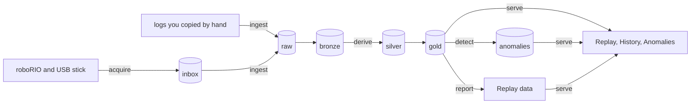

# How Flashpoint works

This page explains what happens to a log between the robot and the screen. It's written for developers, but nothing here needs code. For the design reasoning and the trade-offs, see the [target architecture](../rewrite/05-target-architecture.md) and the [decision records](../adr/README.md).

## The pipeline



| Step | Command | What it does |
|---|---|---|
| Acquire | `flashpoint acquire` | Copies new logs from the robot and USB drives into `inbox/`, checking each copy by size and SHA-256. See [Automatic import](auto-import.md) |
| Ingest | `flashpoint ingest` | Stores each file once in `raw/`, named by its hash. Converts hoots with CTRE's owlet, and reads every record into `bronze/` |
| Derive | `flashpoint derive` (runs after ingest) | Groups logs into sessions, aligns clocks, identifies the match and the devices, frames the phases, and writes `silver/` and `gold/` |
| Detect | `flashpoint detect` (runs after derive) | Compares each match against limits, each unit's history, and its siblings, and writes `gold/anomalies/` |
| Report | `flashpoint report` (runs when `serve` starts) | Builds about 1 MB of Replay data per match in `report/` |
| Serve | `flashpoint serve` | The web app over all of the above |

Each step only redoes work whose inputs changed. Re-running any of them is safe and quick.

### What happens to a `.hoot` file

1. **Raw:** ingest hashes the file. If the ledger has seen that hash, the file is skipped. Otherwise it is copied to `raw/<sha256>.hoot` and recorded in the ledger (`meta/flashpoint.sqlite`). Raw files are never changed.
2. **Convert:** byte 70 of the file gives its format version. Flashpoint picks the matching owlet build from a versioned registry, downloads it on first use into `~/.cache/flashpoint/owlet/`, and converts the hoot. By default it keeps the health signals only (`--profile health`); `--profile all` keeps everything. A file owlet can't read is **quarantined** with a reason instead of stopping the run.
3. **Bronze:** every sample becomes a row in `bronze/samples/` (long format: one row per signal per timestamp). The file's metadata goes to `meta/`.
4. **Silver:** `derive` puts the hoot in a session with its wpilog, shifts its timestamps onto the wpilog's clock, and maps each `Phoenix6/TalonFX-11/...` signal to a robot slot and a physical unit. The result goes to `silver/samples/`.
5. **Gold:** `derive` summarizes each motor for each match phase (energy, current percentiles, temperature, stall time, model residual) into `gold/match_features/`, one row per match × phase × slot × unit. CAN reboots, dropouts, and bus gaps go to `gold/can_health/`, `gold/can_bus_health/`, and `gold/can_events/`.

## The lake

The lake is one folder (default `~/flashpoint-lake`). Everything except `raw/` and the ledger is derived from `raw/`. That's why a backup only needs `raw/` and `meta/`: `restore` followed by `rebuild` regenerates the rest.

| Folder | Holds | Rebuildable |
|---|---|---|
| `raw/` | The original files, named by SHA-256 | No: this is the source of truth |
| `inbox/` | Files `acquire` pulled that are waiting to be ingested | n/a |
| `bronze/samples/` | Every decoded sample, partitioned by season and log | Yes (from raw; `rebuild` reprocesses files from older pipeline versions) |
| `silver/samples/`, `silver/signals/` | Device samples mapped to slots and units on the wpilog clock; declared NetworkTables signals | Yes (`derive --all`) |
| `gold/` | `match_features`, `can_health`, `can_bus_health`, `can_events`, `anomalies` | Yes (`derive --all`) |
| `meta/` | The ledger, plus snapshots of logs, sessions, inventory, units, and triage | The ledger and triage are not rebuildable; back them up |
| `report/` | Replay data and backtest reports | Yes (`report --all`) |

Data is stored as Parquet and queried with DuckDB ([ADR-0001](../adr/0001-storage-parquet-lake-duckdb.md)). Transforms use Polars ([ADR-0002](../adr/0002-transforms-polars.md)).

## Sessions and matches

A **session** is everything one robot logged during one power-on: one wpilog plus one hoot per CAN bus (the rio bus and each CANivore).

A session gets a **match key** like `2026gacmp_qm7`, built as season, event, level (`pm`, `qm`, or `e`), and number. The key comes from:
1. the FMS data inside the wpilog;
2. the filename (`FRC_yyyyMMdd_HHmmss_EVENT_Q7`), only when the log has no FMS match number;
3. nothing. A pit or practice-field session has no key. It still counts toward a unit's usage in History, but it has no Replay entry.

If the filename and the FMS data disagree, FMS wins and the log carries a `match-identity-conflict` warning.

**Framing** splits a session into pre-match, autonomous, teleop, and post-match using the robot mode in the hoot (or the Driver Station data in the wpilog), so match features describe the match and not the time in the queue.

## Clock alignment

Hoot and wpilog timestamps run on different clocks; the offset was 19.56 s on one real match. Flashpoint aligns each hoot to its wpilog, in this order ([ADR-0012](../adr/0012-clock-alignment-shared-payload.md)):

| Method | How | Confidence |
|---|---|---|
| `payload-match` | The swerve pose is written to both the hoot and NetworkTables. Identical payloads pair samples exactly | High (sub-millisecond) |
| `enable-edges` | Robot-enable edges in both logs, paired one to one and checked against the wall clock | Low (30–500 ms) |
| `wall-clock` | The hoot filename time against the wpilog's system time | Very low (seconds) |

Every match feature carries the weakest alignment confidence in its session.

## Slots and units

- A **slot** is a role on a robot: "front-left drive, CAN ID 11, on the rio bus". Slots are declared in `config/robots/<robot>.toml`.
- A **unit** is a physical motor or device, identified by its CTRE serial number.

The robot code logs a CAN inventory (`/Flashpoint/CANInventory`) at boot, which tells Flashpoint which unit sits in which slot ([ADR-0011](../adr/0011-device-identity-ctre-serials.md)). So when a motor moves from one slot or robot to another, its history goes with it.

Logs from before the inventory existed use **legacy** units (`legacy:<slot>:<epoch>`), whose epochs change at swap dates declared in the robot config.

Baselines are per unit. Sibling comparisons are per slot group: the four drive motors, for example.

## Detection

`detect` reads gold only, and every anomaly comes with its evidence and likely causes ([ADR-0010](../adr/0010-anomaly-v1-rules-baselines.md)).

| Kind | Fires when |
|---|---|
| SPEC | A match breaks a fixed limit, such as temperature or a brownout on the battery proxy |
| DRIFT | A unit's metric creeps away from its own baseline over several matches |
| STEP | A unit's metric jumps and stays there, e.g. a loosening connector raising supply path resistance |
| SIBLING | A unit leaves its sibling group (configured per robot) |
| MODEL | Optional. An outlier model, enabled with `--extras ml` and `[model] enabled = true` |

Brownouts are judged on the **battery proxy**: the supply voltage of the robot's declared `battery_proxy` slot (a low-current device on the main power bus, such as the gyro) or, when there is none, the median across devices. A single motor's supply dip is its own wiring drop, not a brownout. That drop instead shows up as **supply path resistance** (mΩ per motor), a baseline metric, so a loosening connector or lead can surface as a STEP, DRIFT, or SIBLING anomaly.

A unit's baseline is the median of its previous matches, up to 20 by default. A unit with fewer than 5 matches is still "building baseline" and gets no DRIFT or STEP. Severity (HIGH, MED, or LOW) comes from how far outside the baseline the value is. The sensitivity setting in the app (relaxed, normal, or strict) changes what is *shown*, never what is computed.

Thresholds live in [`config/anomaly.toml`](../../src/flashpoint/defaults/anomaly.toml), and likely causes in [`config/anomaly-causes.toml`](../../src/flashpoint/defaults/anomaly-causes.toml). `flashpoint backtest` scores detection against the known failures in [`config/failure-labels.toml`](../../config/failure-labels.toml).

## The app

`flashpoint serve` is one local web app with three views ([ADR-0013](../adr/0013-views-one-local-app.md)):
- **Replay**: one match.
- **History**: every unit and slot across matches, events, seasons, and robots.
- **Anomalies**: the anomaly queue, with triage.

Replay can also be exported as a static folder that opens with no server. For a single log in depth, Flashpoint hands off to AdvantageScope instead of rebuilding it ([ADR-0008](../adr/0008-deep-dive-link-advantagescope.md), [ADR-0014](../adr/0014-guarded-advantagescope-launch.md)).

## Querying the lake

`flashpoint.lake.query.connect` opens a DuckDB connection with these views:
- `samples` (bronze);
- `signals` (declared NetworkTables signals);
- one `meta_<name>` view per metadata snapshot, such as `meta_logs`, `meta_sessions`, and `meta_inventory`.

Run these from a checkout with `poetry run python`:

```python
from flashpoint import config
from flashpoint.lake.paths import LakePaths
from flashpoint.lake.query import connect

con = connect(LakePaths(config.lake_root(None)))
con.sql("select filename, fms_event, fms_match_number from meta_logs").show()
con.sql("""
    select ts_us, v_f64 from samples
    where log_id = (select log_id from meta_logs where filename like 'GACMP_Q7_rio%')
      and signal = 'Phoenix6/TalonFX-1/SupplyCurrent'
""").show()
```

Gold tables are plain Parquet, partitioned by season and session:

```python
import duckdb

gold = "~/flashpoint-lake/gold/match_features/*/*/*.parquet"
duckdb.sql(f"""
    SELECT match_key, slot_id, round(temp_max_c) AS max_c, round(supply_energy_wh, 2) AS wh
    FROM read_parquet('{gold}', hive_partitioning = true)
    WHERE phase = 'match' AND subsystem = 'drivetrain'
    ORDER BY match_key, slot_id
""").show()
```

For lifetime questions the app doesn't answer yet, see the marimo notebooks in [`notebooks/`](../../notebooks/README.md).
